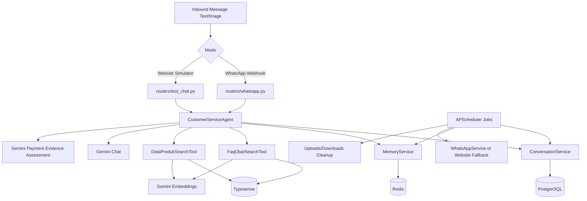
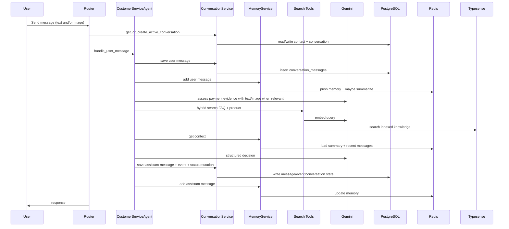
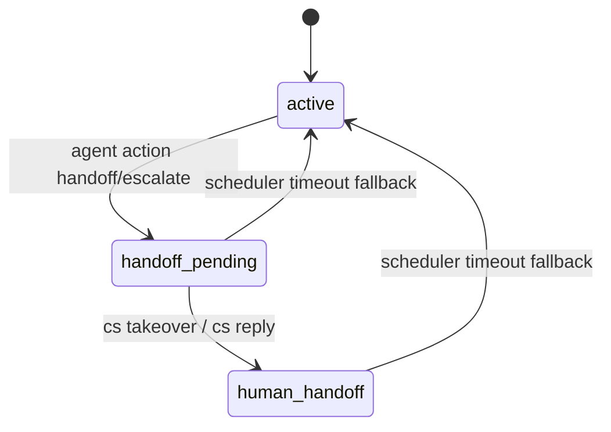

# Qlip CS WhatsApp Agent Technical Documentation

## 1. Purpose of This Document

Dokumen ini menjelaskan implementasi teknis current-state dari project `cs-wa-qlip` berdasarkan kode yang ada di repository saat ini. Fokus dokumen ini adalah:

- menjelaskan arsitektur end-to-end
- menjelaskan peran setiap komponen utama
- menjelaskan flow chat dari inbound message sampai response
- menjelaskan bagaimana Postgres, Redis, Typesense, dan Gemini dipakai
- menjelaskan mode runtime `WhatsApp webhook` dan `website simulator`
- mendokumentasikan keterbatasan implementasi saat ini secara jujur

Dokumen ini tidak mengasumsikan fitur yang belum ada di kode. Semua penjelasan di bawah mengikuti implementasi aktual yang ada di repository.

---

## 2. Repository Snapshot

### 2.1 Stack Utama

- Python `3.12` via `python:3.12-slim`
- FastAPI `0.115.9`
- Uvicorn `0.32.1`
- SQLAlchemy `2.0.34`
- asyncpg `0.30.0`
- Redis client `6.2.0`
- Typesense client access via raw `httpx`
- Google GenAI SDK `1.48.0`

### 2.2 Struktur Folder yang Relevan

- `main.py`: bootstrap aplikasi dan route registration
- `app/core`: konfigurasi settings
- `app/models`: model database
- `app/modules`: adapter low-level untuk DB, Redis, Gemini, dan Typesense
- `app/services`: orchestration logic utama
- `app/tools`: search tool FAQ dan produk
- `app/commands`: command init/index Typesense
- `routers`: HTTP entrypoints
- `templates`: HTML UI untuk simulasi chat web
- `app/data`: seed knowledge base
- `knowledge`: menyimpan dokumen SOP PDF, tetapi saat ini tidak diparsing oleh runtime code
- `docs`: dokumentasi
- `tests`: saat ini kosong
- `migrations`: saat ini kosong

### 2.3 Seed Data Saat Ini

- `faq_obat.json`: `67` item
- `data_produk.json`: `7` item

Field seed data:

- FAQ: `pertanyaan`, `jawaban`
- Produk: `nama_produk`, `function`, `description`, `caution_side_effect`, `aturan_pakai`, `objective`, `pricing`

### 2.4 Observasi Penting Current State

- Folder `tests` belum berisi test suite otomatis.
- Folder `migrations` belum dipakai; schema DB dibuat lewat `Base.metadata.create_all()`.
- `.env.example` masih memuat `OPENAI_API_KEY`, tetapi kode Python saat ini tidak menggunakannya.
- UI web test memakai `Jinja2Templates`, tetapi `jinja2` belum terdaftar eksplisit di `requirements.txt`.

---

## 3. System Overview

Project ini adalah agent customer service untuk Mahva Clinic dengan dua mode operasi:

1. `WhatsApp webhook mode`
   - channel produksi atau integrasi real dengan Meta WhatsApp Cloud API
2. `Website simulator mode`
   - channel development/testing lokal tanpa perlu Meta setup

Agent menerima pesan user, termasuk kombinasi `text` dan `image` dalam satu inbound message, mencari context dari knowledge base, membaca memory percakapan, lalu menghasilkan keputusan terstruktur berupa:

- `reply`
- `handoff`
- `escalate`
- `close`

Namun implementasi runtime saat ini hanya benar-benar memproses state operasional `reply`, `handoff`, dan `escalate`. `close` ada di schema/enum, tetapi belum ada path implementasi yang mengubah conversation menjadi `closed`.

### 3.1 High-Level Architecture



### 3.2 Tanggung Jawab Setiap Store

- Postgres: sumber data persisten untuk contact, conversation, message, dan event
- Redis: memory jangka pendek agent dan summary percakapan
- Typesense: retrieval layer untuk FAQ dan produk
- Gemini Chat: keputusan agent, summarization, dan payment evidence assessment berbasis image
- Gemini Embeddings: membuat vector query dan vector dokumen knowledge base

---

## 4. Runtime Modes

Mode runtime dikontrol oleh environment variable:

- `USE_WHATSAPP_WEBHOOK`
- `USE_WEBSITE`

Perilaku route registration di `main.py`:

- jika `USE_WHATSAPP_WEBHOOK=true`, router WhatsApp diregistrasi
- jika `USE_WEBSITE=true`, router web simulator diregistrasi
- route `/` akan redirect ke `/test-chat` jika `USE_WEBSITE=true`

### 4.1 Mode WhatsApp Webhook

Mode ini mengaktifkan:

- `GET /webhooks/whatsapp`
- `POST /webhooks/whatsapp`
- `POST /webhooks/whatsapp/cs/takeover`
- `POST /webhooks/whatsapp/cs/reply`

Mode ini mengharuskan:

- kredensial WhatsApp Cloud API valid
- endpoint webhook publik jika ingin menerima event real dari Meta

### 4.2 Mode Website Simulator

Mode ini mengaktifkan:

- `GET /test-chat`
- `GET /test-chat/messages`
- `POST /test-chat/send`

Mode ini dipakai untuk testing end-to-end tanpa Meta. Chat tetap melewati service layer yang sama, tetapi entrypoint-nya berbentuk HTTP + HTML UI.

### 4.3 Catatan Mode Campuran

Secara konfigurasi, kedua flag bisa saja aktif bersamaan, tetapi komentar pada `.env.example` menunjukkan intent bahwa development sebaiknya memilih salah satu mode. Dokumentasi operasional sebaiknya menganggap kedua mode ini mutually exclusive untuk menghindari ambiguity channel response.

---

## 5. Application Startup and Shutdown

Saat aplikasi start:

1. logging dikonfigurasi
2. `create_database_schema()` dijalankan
3. `APScheduler` diinisialisasi
4. job expired handoff dijadwalkan berdasarkan `AGENT_SCHEDULER_INTERVAL_SECONDS`
5. job cleanup folder `uploads` dan `downloads` dijadwalkan setiap 3 jam
6. router diregistrasi sesuai mode

Saat aplikasi stop:

1. `APScheduler` di-shutdown
2. background jobs dihentikan secara graceful

### 5.1 Konsekuensi Desain Startup

- DB schema dibentuk otomatis pada startup, bukan lewat migration pipeline.
- `APScheduler` selalu aktif saat app start, bahkan dalam mode website.
- Jika database belum siap, aplikasi gagal start.

---

## 6. End-to-End Request Flow

## 6.1 WhatsApp Inbound Flow

Flow untuk pesan masuk via webhook:

1. Meta mengirim payload ke `POST /webhooks/whatsapp`
2. `WhatsAppService.extract_messages()` mengekstrak message yang didukung
3. untuk setiap message:
   - conversation dicari/dibuat
   - `CustomerServiceAgent.handle_user_message()` dipanggil
   - hasil keputusan agent dikirim kembali ke WhatsApp Cloud API
4. transaksi DB di-commit jika semua message sukses
5. Redis connection ditutup di `finally`

Perlu diperhatikan:

- message `type=text` dan `type=image` didukung
- untuk image, file didownload dari WhatsApp Cloud API ke folder `downloads`
- file non-image akan ditolak dan user diberi instruksi untuk mengirim image
- jika pengiriman balasan ke WhatsApp gagal, transaksi request di-rollback

## 6.2 Website Simulator Flow

Flow untuk testing via web:

1. user membuka `GET /test-chat`
2. user mengisi `wa_id`, `display_name`, dan token dummy
3. user menekan tombol kirim
4. frontend mengirim `multipart/form-data` ke `POST /test-chat/send`
5. request diverifikasi dengan header `X-Dummy-Auth`
6. text dan image opsional diproses dalam satu request
7. image disimpan ke folder `downloads`
8. `CustomerServiceAgent.handle_user_message()` dipanggil
9. hasil response disimpan dan dikembalikan sebagai JSON
10. frontend memanggil ulang `GET /test-chat/messages` untuk refresh transcript

Perbedaan penting dibanding webhook mode:

- tidak ada call ke Meta WhatsApp API pada path `test_chat`
- fallback scheduler pada website mode hanya disimpan ke DB/Redis dan ditampilkan di UI

## 6.3 Handoff Timeout Flow

Scheduler berjalan terus dengan interval:

- `AGENT_SCHEDULER_INTERVAL_SECONDS=45`

Timeout handoff:

- `AGENT_HANDOFF_TIMEOUT_SECONDS=300` detik atau 5 menit

Flow:

1. scheduler mencari conversation dengan status `handoff_pending` atau `human_handoff` yang `handoff_deadline_at <= now`
2. untuk tiap conversation expired:
   - buat fallback message
   - ubah status conversation menjadi `active`
   - simpan fallback message ke Postgres
   - simpan fallback message ke Redis memory
   - kirim via WhatsApp jika mode webhook aktif
   - atau hanya simpan untuk ditampilkan di website mode

## 6.4 Temporary File Cleanup Flow

`APScheduler` menjalankan job cleanup setiap `3 jam` untuk:

- folder `uploads`
- folder `downloads`

Perilaku:

1. setiap file di dua folder tersebut discan rekursif
2. hanya file yang dihapus
3. kegagalan delete file dilog tanpa menghentikan cleanup file lain
4. jumlah file yang berhasil dihapus dicatat ke log

### 6.5 Sequence Diagram



---

## 7. Core Components

## 7.1 `CustomerServiceAgent`

Komponen ini adalah orkestrator utama percakapan.

Tanggung jawab:

- menyimpan pesan user
- menyimpan path file image user bila ada
- memperbarui memory Redis
- memanggil retrieval knowledge FAQ dan produk
- memanggil Gemini untuk menilai bukti pembayaran berbasis text + image
- memanggil LLM untuk keputusan agent
- mengubah status conversation bila perlu
- menyimpan pesan assistant
- menyimpan event agent

### Perilaku Penting

- jika conversation berstatus `human_handoff`, agent tidak melakukan retrieval/decision penuh
- agent langsung mengembalikan canned response bahwa chat dilanjutkan oleh CS
- jika status `handoff_pending`, agent masih tetap menjalankan retrieval dan decision
- precheck pembayaran selalu dievaluasi dengan Gemini sebelum retrieval normal
- jika Gemini menilai ini bukan konfirmasi pembayaran, flow lanjut normal
- jika Gemini menilai ini konfirmasi pembayaran tetapi belum ada image, agent akan meminta user upload bukti pembayaran image
- jika image tidak valid atau tidak jelas, agent akan meminta kirim ulang image
- jika image valid sebagai bukti pembayaran, agent akan handoff ke CS untuk verifikasi
- knowledge retrieval FAQ dan produk dijalankan paralel via `asyncio.gather()`

### Prompt Rules yang Aktif

Prompt agent saat ini menginstruksikan:

- jawab dalam Bahasa Indonesia
- gunakan sapaan `Kak`
- arahkan pasien ke konsultasi dokter online Rp150.000 via chat sebagai default
- video call hanya jika pasien meminta
- jangan membuat diagnosis, resep, atau klaim medis baru

Kondisi wajib handoff menurut prompt:

- refund atau pembatalan setelah bayar
- komplain keras, ancaman, isu legal
- verifikasi bukti pembayaran
- permintaan konsultasi offline
- dokter tidak tersedia atau reschedule kompleks
- pengiriman obat bermasalah
- pertanyaan medis personal yang butuh dokter

## 7.2 `ConversationService`

Service ini mengelola state persisten conversation.

Fungsi utama:

- membuat atau mengambil contact
- membuat atau mengambil conversation aktif terakhir
- menyimpan message
- menyimpan event
- mengubah status handoff
- mengubah status active
- mengambil expired handoff

### Perilaku Penting

- `get_or_create_active_conversation()` tidak hanya mencari status `active`
- service ini mengambil conversation terakhir yang statusnya `!= closed`
- artinya conversation `handoff_pending` dan `human_handoff` tetap dipakai sebagai sesi berjalan

## 7.3 `MemoryService`

Service ini adalah memori jangka pendek agent di Redis.

Fungsi utama:

- menyimpan raw message terbaru
- mengembalikan summary + recent messages
- melakukan summarization jika jumlah raw message melewati threshold

Threshold saat ini:

- `AGENT_MAX_RAW_MESSAGES=10`

TTL saat ini:

- raw message list: `14 hari`
- summary: `30 hari`

### Strategi Summarization

Jika jumlah message dalam Redis melebihi `10`:

1. ambil message lama sebanyak overflow
2. gabungkan dengan existing summary
3. minta Gemini menghasilkan `SummaryOutput`
4. simpan summary baru ke Redis
5. trim raw message sehingga hanya menyisakan `10` message terakhir

### Catatan Arsitektural Penting

- memory agent dibaca dari Redis, bukan dari Postgres
- jika Redis hilang/flush, history yang dipakai agent ikut hilang walaupun message lengkap masih ada di Postgres
- kolom `conversations.summary` ada di database, tetapi saat ini tidak dipakai atau diupdate oleh `MemoryService`

## 7.4 `AgentSchedulerService`

Service ini menyediakan job logic yang dijalankan oleh `APScheduler`.

Fungsi utama:

- memproses expired handoff conversations
- generate fallback message
- re-activate conversation
- store/send fallback
- membersihkan file temporary di `uploads` dan `downloads`

Job service ini menggunakan:

- `AsyncSessionLocal()` sendiri
- Redis connection sendiri
- `WhatsAppService` bila channel webhook aktif

## 7.5 `WhatsAppService`

Service ini berperan sebagai adapter ke WhatsApp Cloud API.

Fungsi utama:

- `send_text()`: kirim text message ke Graph API
- `extract_messages()`: ekstrak pesan `text` dan `image` dari payload webhook Meta
- `_download_media_to_downloads()`: download media image dari WhatsApp Cloud API ke folder `downloads`

### Batasan

- hanya `text` dan `image` yang diproses
- file non-image akan ditolak secara eksplisit
- `WHATSAPP_APP_SECRET` belum dipakai untuk signature verification
- jika token/phone id salah, `send_text()` akan melempar error

## 7.6 Search Tools

Terdapat dua tool:

- `FaqObatSearchTool`
- `DataProdukSearchTool`

Keduanya menyediakan tiga mode:

- `keyword_search`
- `vector_search`
- `hybrid_search`

Agent saat ini memakai `hybrid_search`.

### Karakteristik Search

- query di-embed dulu dengan Gemini embeddings
- vector query dibentuk dalam format Typesense
- field `vector` selalu di-exclude dari response
- `alpha` default hybrid search adalah `0.7`

## 7.7 Gemini Modules

Ada dua modul terpisah:

- `gemini_chat.py`
- `gemini_embeddings.py`

### `gemini_chat.py`

Dipakai untuk:

- structured decision agent
- structured summarization memory
- structured payment evidence assessment menggunakan inline image input
- optional free-text generation helper

### `gemini_embeddings.py`

Dipakai untuk:

- embedding dokumen knowledge base saat indexing
- embedding query user saat search

### Catatan Implementasi

- batch embedding diproses per chunk
- chunking ada, tetapi chunk saat ini masih dijalankan berurutan, bukan paralel
- query FAQ dan product di agent sudah diparalelkan
- payment evidence assessment memakai `types.Part.from_bytes(...)` untuk mengirim image ke Gemini

## 7.8 Typesense Adapter

`typesense_common.py` menyediakan:

- konfigurasi koneksi
- wrapper `request_typesense()`
- wrapper `ensure_ok()`
- loader file JSON

### Catatan Penting

Untuk request `POST` ke endpoint search dokumen, implementasi saat ini menggunakan fallback ke `Typesense /multi_search`.

---

## 8. Persistence Model

## 8.1 PostgreSQL as System of Record

Postgres menyimpan data persisten yang dibutuhkan untuk audit dan kelangsungan session:

- contact
- conversation
- message
- event
- path file yang terkait dengan message

### Tabel `contacts`

Tujuan:

- menyimpan identity user berdasarkan `wa_id`
- menyimpan `display_name`

Field penting:

- `id`
- `wa_id`
- `display_name`
- `metadata`
- `created_at`
- `updated_at`

### Tabel `conversations`

Tujuan:

- menyimpan session percakapan
- menyimpan status handoff dan deadline

Field penting:

- `id`
- `contact_id`
- `status`
- `stage`
- `summary`
- `assigned_to`
- `handoff_reason`
- `handoff_deadline_at`
- `metadata`

### Tabel `conversation_messages`

Tujuan:

- menyimpan transcript persisten seluruh message

Field penting:

- `id`
- `conversation_id`
- `role`
- `content`
- `wa_message_id`
- `files`
- `metadata`
- `created_at`

### Tabel `agent_events`

Tujuan:

- menyimpan jejak event operasional agent dan CS

Contoh event:

- `agent_reply`
- `agent_handoff`
- `agent_escalate`
- `cs_takeover`
- `cs_reply`

## 8.2 Redis as Working Memory

Redis tidak menggantikan Postgres. Redis dipakai sebagai working memory yang cepat untuk reasoning agent.

Key pattern:

- `agent:conversation:{conversation_id}:messages`
- `agent:conversation:{conversation_id}:summary`

### Apa yang Masuk Redis

- message raw terbaru dengan role `user`, `assistant`, atau `human`
- summary teks percakapan

### Apa yang Tidak Masuk Redis

- event operasional
- structured query history
- replay penuh dari Postgres saat Redis kosong

## 8.3 Source of Truth Matrix

| Concern | Storage Utama | Dipakai Oleh | Catatan |
|---|---|---|---|
| Contact identity | Postgres | ConversationService | Persisten |
| Conversation status | Postgres | Agent, Scheduler, CS endpoints | Persisten |
| Full transcript | Postgres | Audit, UI website | Persisten |
| Recent memory | Redis | Agent | TTL 14 hari |
| Conversation summary | Redis | Agent | TTL 30 hari |
| Retrieval knowledge | Typesense | Search tools | Dibangun dari seed JSON |
| LLM output | Tidak disimpan penuh sebagai raw response | Agent events sebagian | Event menyimpan decision dan knowledge |

---

## 9. Conversation State and Session Semantics

## 9.1 Status State Machine

Status yang tersedia:

- `active`
- `handoff_pending`
- `human_handoff`
- `closed`

### State Transition Aktual



### Catatan Current State

- belum ada implementasi yang memindahkan session ke `closed`
- `AgentAction.CLOSE` ada di schema, tetapi belum ada runtime handler

## 9.2 Stage Semantics

Prompt agent meminta model mengembalikan field `stage`, misalnya:

- `new_lead`
- `education`
- `booking`
- `payment`
- `questionnaire`
- `consultation`
- `medicine_invoice`
- `shipping`
- `follow_up`
- `handoff`

Namun implementasi saat ini **tidak** mempersist `decision.stage` kembali ke `conversation.stage`.

Konsekuensinya:

- `conversation.stage` hampir selalu tetap di nilai lama
- default praktisnya adalah `new_lead`
- value `stage` tetap muncul di response JSON `test_chat/send`
- value `stage` juga tersimpan tidak langsung di payload event decision

Dokumentasi atau presentasi tidak boleh mengklaim bahwa stage session saat ini sudah dipersist konsisten antar turn, karena kode saat ini belum melakukan itu.

---

## 10. Knowledge Base and Retrieval

## 10.1 Seed Sources

Knowledge base berasal dari:

- `app/data/faq_obat.json`
- `app/data/data_produk.json`

### FAQ Collection

Schema field:

- `id`
- `pertanyaan`
- `jawaban`
- `document_type`
- `source_file`
- `content`
- `vector`

### Product Collection

Schema field:

- `id`
- `nama_produk`
- `function`
- `description`
- `caution_side_effect`
- `aturan_pakai`
- `objective`
- `pricing`
- `document_type`
- `source_file`
- `content`
- `vector`

## 10.2 Initialization Flow

Command:

- `python -m app.commands.init_typesense`

Perilaku:

- cek apakah collection ada
- jika ada, hapus collection
- buat ulang collection FAQ dan produk
- kedua recreate dijalankan paralel

## 10.3 Indexing Flow

Command:

- `python -m app.commands.index_typesense_data`

Perilaku:

- load seed FAQ dan product
- bentuk field `content`
- buat embedding untuk setiap dokumen
- inject `vector`
- import ke Typesense dengan action `upsert`
- build FAQ dan product documents dijalankan paralel
- import FAQ dan product collection juga dijalankan paralel

## 10.4 Query Flow

Untuk query user:

1. search tool membangun embedding query
2. search tool membentuk vector query string
3. Typesense menerima hybrid search
4. hit terbaik diambil
5. agent mengompaksi hasil menjadi:
   - `text_match`
   - `vector_distance`
   - `document`

---

## 11. HTTP API Reference

## 11.1 Common Routes

| Method | Path | Keterangan |
|---|---|---|
| `GET` | `/health` | health check sederhana |
| `GET` | `/` | redirect ke `/test-chat` jika website mode aktif; jika tidak, return JSON status |

## 11.2 WhatsApp Routes

Aktif jika `USE_WHATSAPP_WEBHOOK=true`.

| Method | Path | Keterangan |
|---|---|---|
| `GET` | `/webhooks/whatsapp` | verifikasi webhook Meta |
| `POST` | `/webhooks/whatsapp` | menerima payload inbound WhatsApp |
| `POST` | `/webhooks/whatsapp/cs/takeover` | menandai session sebagai human handoff |
| `POST` | `/webhooks/whatsapp/cs/reply` | menyimpan balasan CS dan meneruskannya ke WhatsApp |

### `GET /webhooks/whatsapp`

Query params:

- `hub.mode`
- `hub.verify_token`
- `hub.challenge`

Jika token cocok, response adalah challenge string.

### `POST /webhooks/whatsapp`

Body mengikuti payload webhook Meta. Saat ini message `text` dan `image` didukung. Untuk image, file diunduh dari WhatsApp Cloud API dan disimpan sementara ke folder `downloads`.

### `POST /webhooks/whatsapp/cs/takeover`

Body:

```json
{
  "wa_id": "6281234567890",
  "assigned_to": "nama_cs",
  "reason": "opsional"
}
```

### `POST /webhooks/whatsapp/cs/reply`

Body:

```json
{
  "wa_id": "6281234567890",
  "assigned_to": "nama_cs",
  "text": "isi balasan"
}
```

## 11.3 Website Test Routes

Aktif jika `USE_WEBSITE=true`.

| Method | Path | Keterangan |
|---|---|---|
| `GET` | `/test-chat` | render halaman simulator |
| `GET` | `/test-chat/messages` | ambil transcript conversation |
| `POST` | `/test-chat/send` | kirim text dan/atau image user ke agent |

### `GET /test-chat/messages`

Query:

- `wa_id`

Response mengembalikan seluruh message conversation dalam urutan ascending. Response juga memuat:

- `is_fallback_timeout`
- `files`

`is_fallback_timeout` dipakai UI untuk menandai message fallback yang dibuat scheduler. `files` berisi absolute path file image yang tersimpan untuk message tersebut.

### `POST /test-chat/send`

Header:

- `X-Dummy-Auth`

Body berupa `multipart/form-data` dengan field:

- `wa_id`
- `display_name`
- `text`
- `image` (optional, image only)

Response:

```json
{
  "status": "ok",
  "conversation_id": "uuid",
  "reply": "teks jawaban agent",
  "action": "reply|handoff|escalate|close",
  "stage": "stage dari output model",
  "confidence": 0.0,
  "files": ["absolute/path/to/image"]
}
```

### Catatan Website Route

`GET /test-chat/messages` memanggil `get_or_create_active_conversation()`. Artinya, membuka transcript untuk `wa_id` baru dapat membuat row conversation baru walaupun belum ada message.

---

## 12. Configuration Reference

## 12.1 Environment Variables yang Dipakai Runtime

| Variable | Default | Dipakai Oleh | Keterangan |
|---|---|---|---|
| `DATABASE_URL` | local postgres | database module | koneksi Postgres |
| `REDIS_URI` | local redis | redis client | koneksi Redis |
| `TYPESENSE_URI` | `http://localhost:8108` | Typesense adapter | URL Typesense |
| `TYPESENSE_API_KEY` | placeholder/default | Typesense adapter | API key |
| `TYPESENSE_VECTOR_DIM` | `1536` | embeddings + Typesense schema | dimensi vector |
| `TYPESENSE_TIMEOUT_SECONDS` | `30` | Typesense adapter | timeout HTTP |
| `GEMINI_EMBEDDING_MODEL` | `models/gemini-embedding-001` | embeddings module | model embedding |
| `GEMINI_EMBEDDING_TASK_TYPE` | `RETRIEVAL_DOCUMENT` | embeddings module | task type Gemini |
| `GEMINI_EMBEDDING_BATCH_SIZE` | `10` | embeddings module | ukuran batch embed |
| `GEMINI_API_KEY` | empty | chat + embeddings | wajib untuk LLM dan embeddings |
| `WHATSAPP_ACCESS_TOKEN` | placeholder | WhatsApp adapter | bearer token Meta |
| `WHATSAPP_PHONE_NUMBER_ID` | placeholder | WhatsApp adapter | phone number id |
| `WHATSAPP_BUSINESS_ACCOUNT_ID` | placeholder | saat ini belum dipakai runtime | disimpan di settings |
| `WHATSAPP_VERIFY_TOKEN` | placeholder | webhook verify | verifikasi webhook |
| `WHATSAPP_APP_SECRET` | placeholder | saat ini belum dipakai runtime | belum dipakai untuk signature validation |
| `WHATSAPP_GRAPH_API_VERSION` | `v20.0` | WhatsApp adapter | versi Graph API |
| `WHATSAPP_GRAPH_API_BASE_URL` | `https://graph.facebook.com` | WhatsApp adapter | base URL Graph API |
| `UPLOADS_DIR` | `uploads` | APScheduler cleanup | folder temporary uploads |
| `DOWNLOADS_DIR` | `downloads` | webhook image download, website upload, APScheduler cleanup | folder temporary downloads |
| `USE_WHATSAPP_WEBHOOK` | `false` | `main.py`, scheduler | aktifkan mode webhook |
| `USE_WEBSITE` | `true` | `main.py`, router test, scheduler | aktifkan web simulator |
| `WEBSITE_DUMMY_AUTH_TOKEN` | `dev-token` | `test_chat.py` | dummy auth web mode |
| `GEMINI_CHAT_MODEL` | `models/gemini-3-flash-preview` | chat module | model decision + summary |
| `AGENT_MAX_RAW_MESSAGES` | `10` | memory service | batas raw messages sebelum ringkas |
| `AGENT_HANDOFF_TIMEOUT_SECONDS` | `300` | conversation + scheduler | timeout handoff |
| `AGENT_SCHEDULER_INTERVAL_SECONDS` | `45` | scheduler | interval polling expired handoff |

## 12.2 Variable yang Ada tetapi Belum Dipakai Runtime

- `OPENAI_API_KEY`
- `WHATSAPP_BUSINESS_ACCOUNT_ID` belum dipakai oleh logic Python saat ini
- `WHATSAPP_APP_SECRET` sudah ada di settings, tetapi belum dipakai untuk signature validation

---

## 13. Local Setup and Operation

## 13.1 Prerequisites

Agar flow end-to-end berjalan, environment lokal minimal butuh:

- PostgreSQL
- Redis
- Typesense
- Python environment
- Gemini API key valid

Jika memakai mode webhook real, juga butuh:

- Meta WhatsApp Cloud API credentials
- public tunnel atau deployment publik

### Catatan Docker Saat Ini

`docker-compose.yml` saat ini hanya menjalankan service `app`. Postgres, Redis, dan Typesense belum didefinisikan di compose file tersebut. Jadi local infra masih harus disediakan terpisah.

## 13.2 Installation

```bash
pip install -r requirements.txt
```

`requirements.txt` saat ini sudah mencakup dependency penting seperti `jinja2`, `apscheduler`, `python-multipart`, dan library runtime lain yang dipakai kode.

## 13.3 Environment Setup

1. copy `.env.example` ke `.env`
2. isi semua koneksi lokal yang valid
3. isi `GEMINI_API_KEY`
4. pilih mode:
   - development: `USE_WEBSITE=true`, `USE_WHATSAPP_WEBHOOK=false`
   - webhook: `USE_WEBSITE=false`, `USE_WHATSAPP_WEBHOOK=true`

## 13.4 Initialize Knowledge Base

Jalankan:

```bash
python -m app.commands.init_typesense
python -m app.commands.index_typesense_data
```

## 13.5 Run Application

```bash
uvicorn main:app --reload --host 0.0.0.0 --port 8000
```

## 13.6 Website Mode Smoke Test

1. set `USE_WEBSITE=true`
2. buka `http://127.0.0.1:8000/`
3. aplikasi akan redirect ke `/test-chat`
4. kirim pesan dari UI
5. lihat transcript dan status action

### Scenario yang Disarankan

- tanya FAQ umum
- tanya produk tertentu
- kirim text konfirmasi pembayaran tanpa image untuk memastikan agent meminta bukti image
- kirim text + image bukti pembayaran untuk memastikan agent melakukan handoff
- diamkan sampai timeout 5 menit
- refresh UI untuk melihat fallback timeout badge

## 13.7 WhatsApp Mode Smoke Test

1. set `USE_WHATSAPP_WEBHOOK=true`
2. set semua credential WhatsApp valid
3. expose aplikasi ke internet
4. daftarkan URL ke Meta
5. verifikasi webhook via `GET /webhooks/whatsapp`
6. kirim pesan real dari user WhatsApp

---

## 14. Logging and Observability

Format log saat ini:

```text
%(asctime)s | %(levelname)s | %(name)s | %(message)s
```

Log yang penting untuk operasi:

- startup/shutdown aplikasi
- APScheduler startup/shutdown
- jumlah expired handoff
- temporary file cleanup summary
- payment evidence assessment
- knowledge retrieval result count
- Gemini request start
- memory summarization
- Typesense request mode
- WhatsApp send success/failure

Contoh interpretasi log:

- `Processing 0 expired handoff conversations`
  - job expired handoff aktif dan tidak menemukan handoff expired
- `Applying fallback for conversation_id=...`
  - timeout handoff terjadi dan fallback sedang diproses
- `Temporary file cleanup completed ...`
  - job cleanup file temporary berhasil berjalan
- `WhatsApp send failed ... 401`
  - kredensial WhatsApp Cloud API tidak valid atau belum diisi

---

## 15. Known Limitations and Current Gaps

Bagian ini penting karena mencatat gap implementasi yang nyata.

### 15.1 Data and State

- `conversation.stage` tidak dipersist dari `decision.stage`
- `conversations.summary` ada di schema DB, tetapi tidak dipakai oleh logic memory
- jika Redis hilang, agent tidak merekonstruksi memory dari Postgres

### 15.2 Routing and Session Behavior

- `GET /test-chat/messages` bisa membuat conversation baru tanpa message
- file non-image belum didukung pada jalur upload user

### 15.3 Security

- tidak ada signature verification untuk payload WhatsApp webhook
- website simulator memakai dummy auth sederhana, bukan autentikasi production-grade

### 15.4 Infra and Delivery

- `docker-compose.yml` belum mencakup Postgres, Redis, dan Typesense
- `migrations` belum digunakan
- `tests` belum diimplementasikan

### 15.5 Product and Agent Behavior

- action `close` tersedia di enum/schema tetapi belum diproses sebagai state transition
- knowledge document di folder `knowledge` belum di-ingest ke sistem
- hanya `text` dan `image` yang diproses pada inbound message
- penilaian bukti pembayaran sangat bergantung pada output Gemini; belum ada rule engine deterministic tambahan

### 15.6 Dependency Hygiene

- template web bergantung pada `jinja2`, tetapi dependency belum eksplisit di `requirements.txt`

---

## 16. Simple Use Cases

## 16.1 FAQ Answer

Contoh:

- user bertanya: `Apakah Fat Burner boleh diminum jika tidak berolahraga?`

Flow:

1. message masuk
2. conversation aktif dicari
3. message user disimpan ke Postgres dan Redis
4. agent melakukan hybrid search FAQ + produk
5. Gemini memutuskan `reply`
6. balasan assistant disimpan
7. response dikirim ke channel aktif

## 16.2 Product Recommendation Context

Contoh:

- user bertanya tentang fungsi dan harga produk

Flow:

1. query di-embed
2. product collection dicari di Typesense
3. product hits dimasukkan ke prompt
4. agent menjawab berdasarkan knowledge yang tersedia

## 16.3 Payment Proof Verification

Contoh:

- user mengirim text konfirmasi pembayaran, dengan atau tanpa image

Flow:

1. agent menyimpan text dan path file image bila ada
2. Gemini menilai apakah ini benar konfirmasi pembayaran
3. jika belum ada image, agent meminta user upload bukti pembayaran dalam format image
4. jika image tidak jelas atau tidak valid, agent meminta user kirim ulang image
5. jika image valid sebagai bukti pembayaran, agent mengembalikan `handoff`
6. conversation jadi `handoff_pending`
7. jika CS takeover, status pindah ke `human_handoff`
8. jika tidak ada respon sampai timeout, job handoff fallback mengembalikan conversation ke `active`

## 16.4 Website-Only Development Demo

Contoh:

- developer ingin demo flow tanpa Meta setup

Flow:

1. aktifkan `USE_WEBSITE=true`
2. buka `/test-chat`
3. kirim pesan dummy
4. lihat transcript full dari Postgres
5. lihat fallback timeout muncul di UI bila handoff tidak dijawab

---

## 17. Recommended Next Technical Steps

Jika project ini akan dinaikkan level readiness-nya, urutan prioritas yang masuk akal adalah:

1. persist `conversation.stage` dari `decision.stage`
2. tambahkan migration management yang benar
3. tambahkan automated test untuk service dan router utama
4. tambahkan signature verification untuk webhook Meta
5. tambahkan rehydration strategy dari Postgres ke Redis jika memory hilang
6. tambahkan validasi lanjutan pasca-assessment Gemini untuk fraud/risk check jika diperlukan
7. lengkapi `docker-compose` dengan Postgres, Redis, dan Typesense
8. definisikan path nyata untuk `close` action

---

## 18. Final Summary

Secara arsitektural, project ini sudah memiliki fondasi agentic CS yang cukup jelas:

- session persisten di Postgres
- working memory di Redis
- retrieval knowledge di Typesense
- decision, summarization, dan payment evidence assessment via Gemini
- timeout recovery dan temp file cleanup via APScheduler
- dua mode channel: webhook real dan website simulator

Namun current-state implementation masih paling cocok disebut sebagai `working internal agent service` yang sudah bisa didemokan end-to-end, tetapi belum sepenuhnya hardened untuk production scale karena masih ada gap pada migration, testing, security validation, dan sebagian state persistence.
